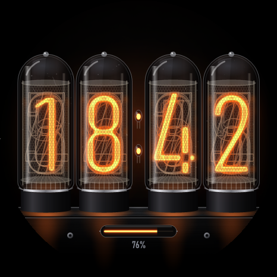

# Nixie — watch face for Wear OS

A nixie tube clock for round Wear OS watches (built for the OnePlus Watch 3, 466×466). Four IN-14 style tubes with glowing wire digits, the unlit cathode stack visible behind them, a hex mesh in front, and a neon battery gauge on the base.

<p align="center"></p>

## Features

- Hours and minutes on four tubes, following the 12/24 h system setting
- Each digit glows at its own depth in the cathode stack, as a sheath of light around a darker metal core, and lights the cathodes, mica discs and rods next to it
- Hot core, orange halo and a faint violet haze that spills through the glass; the lit digit reflects in the curved walls and onto the base
- Tubes drawn as cylinders seen slightly from above: dark thick walls, a cage whose cells bunch up toward the sides, elliptical collars and discs, contact shadows
- Tilt parallax: the far cage, the near cage and the reflections on the glass slide against the digits as the wrist rolls (accelerometer)
- Tubes warm up with a short flicker each time the watch wakes, and the outgoing digit ghosts for a second when the minute changes
- No two tubes are alike: brightness, glass tone, dust and scratches differ per tube
- Neon colon bulbs, battery bar and percentage on the base
- Dimmed always-on (ambient) mode: digits only

## How it is built

Pure [Watch Face Format v2](https://developer.android.com/training/wearables/wff) — the APK contains resources only, no code. Every bitmap is rendered procedurally; there are no photos or stock art.

- `tools/NixieRender.cs` draws the tubes, digits and glow (System.Drawing with a custom blur/erode and layered additive glow). `tools/render.ps1` compiles and runs it into `res/drawable`.
- `tools/gen-xml.ps1` writes `res/raw/watchface.xml` — one image per digit per tube, switched by an alpha expression.
- `tools/mock.ps1` composites a test frame locally, without a watch.
- `build.ps1` builds the APK without Gradle (aapt2 → zipalign → apksigner, debug key).

```powershell
.\tools\render.ps1              # regenerate bitmaps
.\tools\gen-xml.ps1             # regenerate watchface.xml
.\build.ps1                     # build\nixie.apk
.\build.ps1 -Install            # build + adb install on the connected watch
```

Requires PowerShell 7, the Android SDK (build-tools 37, platform android-34) and a JDK.

## Install

Grab the APK from [Releases](../../releases) and sideload it:

```
adb install nixie.apk
```

Then long-press the current watch face and pick **Nixie**. Needs Wear OS 4 or newer.

Font: Oswald, under the SIL Open Font License.
